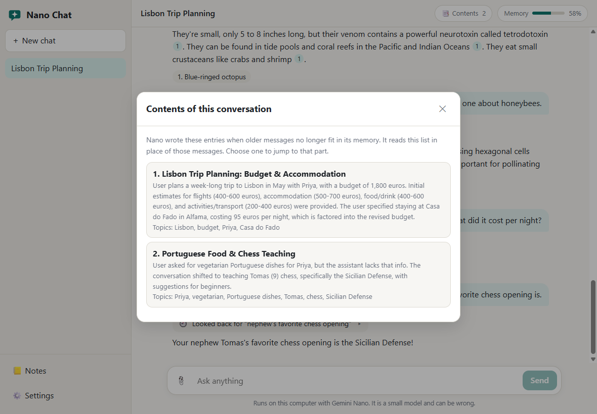
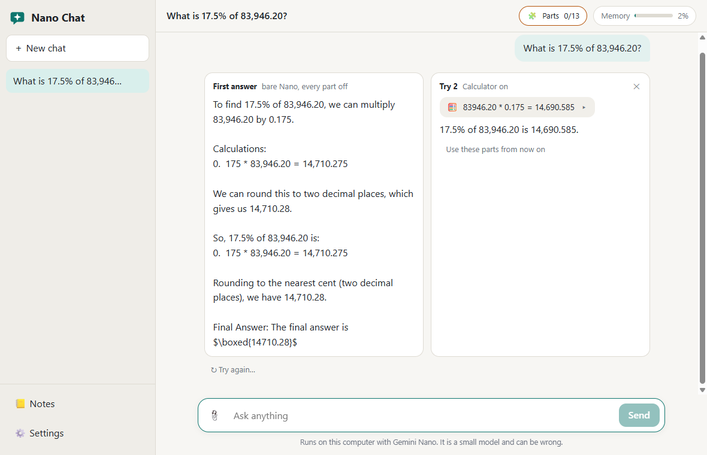

# Nano Chat

A chatbot that runs entirely on **Gemini Nano**, the small language model built into Chrome.
No account, no API key, and no other language model. Your conversations stay in your browser.

**Try it:** https://toontalk.github.io/nano-chat/

## What you need

- Chrome 148 or newer on a Windows, Mac or Linux computer, or a Chromebook Plus.
- About 22 GB of free disk space, and either a graphics card with more than 4 GB of memory
  or 16 GB of RAM.
- The first visit downloads the model (a few gigabytes), once for all sites.

Phones and tablets are not supported by Chrome's built-in model yet.

## Working around a small model

Gemini Nano can hold only about 9,000 tokens at once and has no tool calling of its own.
Nano Chat does these jobs in the page instead.

| Limit | What the page does |
| --- | --- |
| Small context window | The page keeps the whole transcript. Nano sees its instructions, your notes, a **contents list** of the older parts, and the recent messages. |
| Forgetting older messages | When the window fills, a side session writes a contents entry (title, topics, gist) for the oldest stretch. To look back, Nano picks a contents entry, or the page searches the transcript by keyword, or both (a setting). |
| No tool calling | A separate small session chooses a tool as JSON. The page runs the tool and hands Nano the result along with your message. |
| Weak arithmetic | A real calculator in the page, with percentages and date math. Plain arithmetic never goes to the model at all. |
| No knowledge of recent events | Web search: Wikipedia with no key, or Tavily or Serper with your own key. Answers cite their sources. |
| Long documents | A pasted link, a long paste or an attached text file is searched for the relevant passages, or summarized in parts by side sessions. |
| No memory between chats | Notes. Say "Remember that..." and it is saved in the browser and available in every chat. |

Click the **Memory** pill to see exactly what Nano can see at that moment, and click any tool
chip under a reply to see what the tool gave it.

## Tools

| Tool | When it is used |
| --- | --- |
| Calculator | Arithmetic, percentages, powers, `sqrt` and friends, and dates: `daysBetween(today, 2026-12-25)`, `addDays`, `weekday`. |
| Web search | Facts about people, places, works, science and history, and anything recent. |
| Read a page | When your message contains a link. |
| Save a note / read a note | "Remember that...", and later questions about your own things. |
| Look back | Questions about earlier parts of a long conversation or an attached document. |

You can also ask for a tool yourself by starting a message with `/search`, `/calc`, `/note`
(save a note), `/read` (open a note) or `/recall` (look back).

## Take it apart, or build it up

How much of a chatbot is the model, and how much is everything around it? Every part this
page adds has a switch (the **Parts** button at the top).

- **Ablation:** start with everything on and switch one part off to see what it was doing.
- **Construction:** start from bare Gemini Nano and add parts one at a time. Open
  [the page with `?start=bare`](https://toontalk.github.io/nano-chat/?start=bare), or choose
  "Start from bare Nano" on the welcome screen. The page suggests things to try that the
  missing parts would have handled.

| Part | Switched off |
| --- | --- |
| Instructions | Nano gets no briefing, only your messages. |
| Today's date | Nano has no clock and can only guess the date. |
| Notes | Nothing carries over from one chat to the next. |
| Contents list | When memory fills, the oldest messages simply fall out of view. |
| Looking back | Nano cannot reread anything that has left its memory. |
| Calculator | Nano does arithmetic in its head. |
| Web search | Nano answers from what it remembers from training. |
| Reading links | Nano sees only the address and has to guess what is there. |
| Long texts | A long text goes into the message as it is and is cut off where memory ends. |
| Rules of thumb | Nano alone decides which tool each message needs. |
| Made-up results guard | You see pretend tool results when Nano writes them. |
| Formatting | You see the raw Markdown characters. |
| Chat titles | A chat is named by its first words. |
| Second look (extra, off at first) | A second copy of Nano checks each answer. |

Three things make the experiments quick:

- **Try again.** Under any reply, "Try again…" runs the same message with other parts
  switched on and shows the answers side by side. When a reply would probably have been
  different with a part that is off, the page offers that try itself.
- **Run it more than once.** Chrome does not let a page set the model's temperature, so
  Nano does not answer the same way twice. "Run 3 times" shows how much is chance.
- **A small memory.** A switch pretends Nano's memory is 1,500 tokens, so the contents list
  and looking back show up after a few messages. `?window=1500` in the address does the same.

Each reply records which parts were on when it was written.

## The coach (optional)

With your own key for Claude, Gemini or ChatGPT, a stronger model can look over Nano's
shoulder. It is sent what the glass box shows (your message, what the tools found, which
parts were on, and Nano's reply) and it:

- asks what you think of the reply before it says anything;
- gives a hint first when you missed a problem;
- rates the reply, marks the words it objects to, and explains why the reply came out that
  way in terms of the parts;
- suggests an experiment, with a button that runs it as a second try.

The coach never joins the chat, and Nano does not see what it says. It runs only when you
ask, or after every reply, as you choose in Settings. It can be wrong too. It knows nothing
recent unless you let it use its company's web search, which is charged per search.

## Be aware

Gemini Nano is a small model. It can state wrong things with confidence, even with a search
result in front of it, and it sometimes does sums in its head instead of using the
calculator. Open the tool chips and the sources to check what an answer rests on.

## Where your data goes

- Conversations are stored in this browser (IndexedDB), notes and settings in local storage.
- A web search sends the search words to Wikipedia, or to Tavily or Serper if you add a key.
- Reading a link fetches that page. If the site refuses, the page is fetched through the
  `r.jina.ai` reader, which you can turn off in Settings.
- With the coach switched on, each reply it reviews goes to the company whose key you gave,
  together with your message, the few messages before it, and what the tools found.
- Nothing else leaves your computer. Keys are kept only in this browser.

## Files

- `index.html`: the whole app in one file, with no dependencies. It also works opened
  straight from disk.
- `tools/`: tests that drive a headless Chrome with the real Gemini Nano (Windows, Node 24).
  They copy the installed model into a throwaway profile, so your own Chrome profile is not
  touched.
  - `node tools/test.mjs quick`: calculator, tools, notes.
  - `node tools/test.mjs long`: a long conversation in a pretend 1,500-token window, to
    exercise the contents list and looking back.
  - `node tools/test-stop.mjs`: the Stop button.
  - `node tools/test-parts.mjs`: the switches, second tries, the bare start and the coach
    (add `memory` or `coach` to run only that section). The coach's three services are faked
    in this test, apart from a check that each can be reached from a page.

## License

MIT
