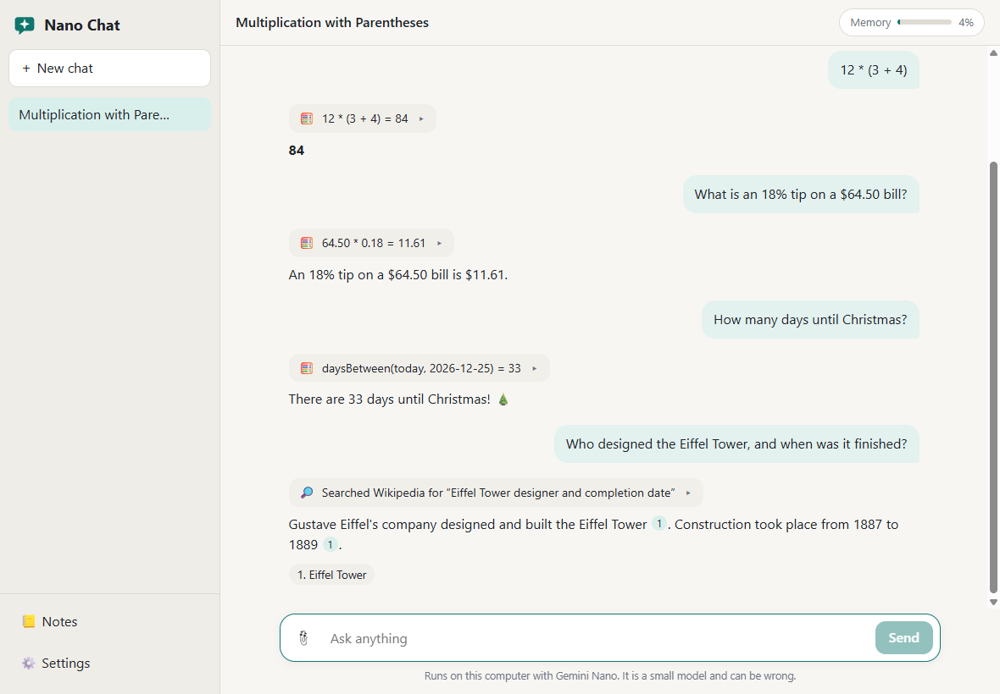
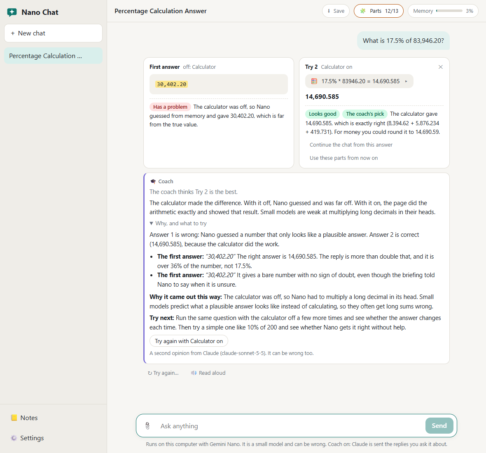

# Nano Chat

A chatbot that runs entirely on **Gemini Nano**, the small language model built into Chrome,
or on **Aion Instruct**, Microsoft's small model in Edge.
No account, no API key, and no other language model. Your conversations stay in your browser.

**Try it:** https://toontalk.github.io/nano-chat/

- [Guide for students](https://toontalk.github.io/nano-chat/student-guide.html): eight experiments, starting from the bare model.
- [Guide for teachers](https://toontalk.github.io/nano-chat/teacher-guide.html): what students can learn, what the computers need, a lesson outline.
- [How it was made](https://toontalk.github.io/nano-chat/making-of.html): the account of building it with Claude, including what went wrong.
- [Nano beside older models](https://toontalk.github.io/nano-chat/older-models.html): the same page run on GPT-2 from 2019, and Nano beside answers the first ChatGPT gave in December 2022, with 30 examples of each.
- Ken Kahn's post: [Claude helped me make an app for exploring how to turn an LLM into a chatbot](https://docs.google.com/document/d/100TuZ1hSkCIE6gXLNsJulXOVqc7B5ghLfRsPteOIb-Y/edit?usp=sharing)

## What you need

- Chrome 148 or newer on a Windows, Mac or Linux computer, or a Chromebook Plus.
- About 22 GB of free disk space, and either a graphics card with more than 4 GB of memory
  or 16 GB of RAM.
- The first visit downloads the model (a few gigabytes), once for all sites.

Phones and tablets are not supported by Chrome's built-in model yet.

### Or Microsoft Edge

Edge offers the same Prompt API, running Microsoft's own model, Aion Instruct (2.3 billion
parameters, a download of about 1.2 GB). In Edge 158 it is still switched off by default:

- Open `edge://flags`, find "Prompt API", set it to Enabled, and restart Edge.
- Edge runs it on Windows 10 or 11, on macOS 13.3 or newer, and from Edge 159 on Linux, with
  about 20 GB of free disk space and a graphics card with 3 GB of memory. Not on phones.

Everything works there except pictures and sound: Edge 158 gives its model text only. The page
asks the model each time it starts, so if a later Edge adds them they will work without a
change. In Edge the page calls the model Aion instead of Nano. Its memory is a little smaller
(7,168 tokens to Nano's 9,216), and the memory parts scale to it. Tried on 24 November 2026 in
Edge 158 on Windows: answers came in one to two seconds.

## Working around a small model

Gemini Nano can hold only about 9,000 tokens at once and has no tool calling of its own.
Nano Chat does these jobs in the page instead.

| Limit | What the page does |
| --- | --- |
| Small context window | The page keeps the whole transcript. Nano sees its instructions, your notes, a **contents list** of the older parts, and the recent messages. |
| Forgetting older messages | When the window fills, a side session writes a contents entry (title, topics, gist) for the oldest stretch. To look back, Nano picks a contents entry, or the page searches the transcript by keyword, or both (a setting). |
| No tool calling | A separate small session chooses a tool as JSON. The page runs the tool and hands Nano the result along with your message. |
| Weak arithmetic | A real calculator in the page, with percentages and date math. Plain arithmetic never goes to the model at all. |
| No knowledge of recent events | Web search: Wikipedia with no key; Tavily or Serper with your own key; or through Claude, Gemini or ChatGPT if you gave a key for the coach (that AI searches and reports what the pages say, and Nano still writes the answer). Answers cite their sources. |
| Text only, by default | Chrome's Nano can also take pictures and sound. The paperclip attaches a picture or a sound file, takes a photo, or records from the microphone, and the page hands them to Nano beside your words. |
| Long documents | A pasted link, a long paste or an attached text file is searched for the relevant passages, or summarized in parts by side sessions. |
| No memory between chats | Notes. Say "Remember that..." and it is saved in the browser and available in every chat. |

Click the **Memory** pill to see exactly what Nano can see at that moment, and click any tool
chip under a reply to see what the tool gave it.

## Tools

| Tool | When it is used |
| --- | --- |
| Calculator | Arithmetic, percentages, powers, `sqrt` and friends, and dates: `daysBetween(today, 2026-12-25)`, `addDays`, `weekday`. |
| Web search | Facts about people, places, works, science and history, and anything recent. |
| Read a page | When your message contains a link. |
| Save a note / read a note | "Remember that...", and later questions about your own things. |
| Look back | Questions about earlier parts of a long conversation or an attached document. |

Four more things are not tools Nano chooses, but conveniences of the page:

- **Pictures and sound in.** A picture takes about 263 of Nano's 9,216 tokens whatever its size, and
  sound about 8 tokens a second. After its reply, Nano is asked separately to put each
  picture or recording into words. You can read that under it, and the page uses it for
  the contents list, for looking back, and for the coach. On computers where Chrome gives
  Nano text only, the paperclip offers files alone.
- **Pictures out.** When Nano writes SVG code, the page draws it, with the code a click away.
  Ask it to "draw a red circle". The picture is shown through an ``, where nothing in
  it can run, and scripts are stripped before it is drawn or saved.
- **Save.** The Save button turns the chat into a single web page you can keep or pass on,
  with the tool chips still openable.
- **Voice.** In Settings you can add a microphone button and have replies read aloud. The
  page asks Chrome to recognize speech on your computer. Chrome's online recognition, which
  sends your voice to Google, is used only if you allow it. Reading aloud uses the
  computer's own voices unless you pick one marked "online".

You can also ask for a tool yourself by starting a message with `/search`, `/calc`, `/note`
(save a note), `/read` (open a note) or `/recall` (look back).

## Take it apart, or build it up

How much of a chatbot is the model, and how much is everything around it? Every part this
page adds has a switch (the **Parts** button at the top).

- **Ablation:** start with everything on and switch one part off to see what it was doing.
- **Construction:** start from bare Gemini Nano and add parts one at a time. Open
  [the page with `?start=bare`](https://toontalk.github.io/nano-chat/?start=bare), or choose
  "Start from bare Nano" on the welcome screen. The page suggests things to try that the
  missing parts would have handled.

| Part | Switched off |
| --- | --- |
| Instructions | Nano gets no briefing, only your messages. |
| Today's date | Nano has no clock and can only guess the date. |
| Notes | Nothing carries over from one chat to the next. |
| Contents list | When memory fills, the oldest messages simply fall out of view. |
| Looking back | Once old messages no longer fit in Nano's memory, Nano cannot go back and read them. |
| Calculator | Nano does arithmetic in its head. |
| Web search | Nano answers from what it remembers from training. |
| Reading links | Nano sees only the address and has to guess what is there. |
| Long texts | A long text goes into the message as it is and is cut off where memory ends. |
| Pictures and sound | Nano is told only that a picture or a recording was attached. |
| Rules of thumb | Nano alone decides which tool each message needs. |
| Made-up results guard | You see pretend tool results when Nano writes them. |
| Formatting | You see the raw Markdown characters. |
| Chat titles | A chat is named by its first words. |
| Second look (extra, off at first) | A second copy of Nano checks each answer. |

In the Parts panel each part has a "More about this" line that explains it at more length,
with an example. Settings has the same for its less obvious choices.

Four things make the experiments quick:

- **Try again.** Under any reply, "Try again…" runs the same message with other parts
  switched on and shows the answers side by side. When a reply would probably have been
  different with a part that is off, the page offers that try itself.
- **Run it more than once.** Chrome does not let a page set the model's temperature, so
  Nano does not answer the same way twice. "Run 3 times" shows how much is chance.
- **A small memory.** A switch pretends Nano's memory is 1,500 tokens, so the contents list
  and looking back show up after a few messages. `?window=1500` in the address does the same.

- **Rewrite the instructions.** Settings shows the words the page gives Nano before your
  first message, the "system prompt", and lets you change them: the briefing, and the line
  each kind of part adds. "Back to the page's words" undoes it. A reply written under your
  own instructions says so, and the coach is shown them.

Each reply records which parts were on when it was written.

Nano itself remembers only one answer to each message: the first, unless you choose
"Continue the chat from this answer" on a later try.

## The coach (optional)

With your own key for Claude, Gemini or ChatGPT, a stronger model can look over Nano's
shoulder. "Other" takes the address and model name of any service, or a program on your own
computer such as Ollama, that speaks the OpenAI chat format. It is sent what the glass box shows (your message, what the tools found, which
parts were on, and Nano's reply) and it:

- asks what you think of the reply before it says anything;
- gives a hint first when you missed a problem;
- rates the reply, marks the words it objects to, and explains why the reply came out that
  way in terms of the parts;
- takes your opinion in your own words as a fourth answer, and replies to what you wrote;
- lets you go on talking with it about the reply;
- suggests an experiment, with a button that runs it as a second try;
- when a message has several answers, asks which you think is best, then comments on each
  one and says what the difference between them shows.

The coach never joins the chat, and Nano does not see what it says. It runs only when you
ask, or after every reply, as you choose in Settings. It can be wrong too. It knows nothing
recent unless you let it use its company's web search, which is charged per search.

## Be aware

Gemini Nano is a small model. It can state wrong things with confidence, even with a search
result in front of it, and it sometimes does sums in its head instead of using the
calculator. Open the tool chips and the sources to check what an answer rests on.

## Where your data goes

- Conversations are stored in this browser (IndexedDB), notes and settings in local storage.
- A web search sends the search words to Wikipedia, or to Tavily or Serper if you add a key.
- Reading a link fetches that page. If the site refuses, the page is fetched through the
  `r.jina.ai` reader, which you can turn off in Settings.
- With the coach switched on, each reply it reviews goes to the company whose key you gave,
  together with your message, the few messages before it, and what the tools found.
- Pictures, photos and recordings stay in this browser with their chat and are given to
  Nano on your computer. The camera and microphone are used only when you choose "Take a
  photo" or "Record sound". The coach gets Nano's description of them. A picture itself
  goes to the coach's company only if you tick "Let the coach see pictures I attach";
  recordings are never sent.
- Voice input stays on your computer unless you allow Chrome's online speech recognition.
- Nothing else leaves your computer. Keys are kept only in this browser, or only until
  the tab is closed if you tick the box beside the key.
- Each chat and note has a delete button. Settings can delete all chats, all notes, or
  everything including settings and keys, for a computer that someone else will use next.

## Files

- `index.html`: the whole app in one file, with no dependencies. It also works opened
  straight from disk.
- `tools/`: tests that drive a headless Chrome with the real Gemini Nano (Windows, Node 24).
  They copy the installed model into a throwaway profile, so your own Chrome profile is not
  touched.
  - `node tools/test.mjs quick`: calculator, tools, notes.
  - `node tools/test.mjs long`: a long conversation in a pretend 1,500-token window, to
    exercise the contents list and looking back.
  - `node tools/test-stop.mjs`: the Stop button.
  - `node tools/test-parts.mjs`: the switches, second tries, the bare start and the coach
    (add `memory` or `coach` to run only that section). The coach's three services are faked
    in this test, apart from a check that each can be reached from a page.
  - `node tools/test-coach-live.mjs`: the coach with a real Claude key, read from the
    `ANTHROPIC_API_KEY` environment variable (add `web` to try its web search too). It costs
    a few cents a run. The key stays in the test process and is never put into the page.
  - `node tools/build-artifact.mjs`: builds `artifact/nano-chat-artifact.html`, a copy to publish
    as a Claude artifact (see below). `node tools/test-artifact.mjs` checks it, with a stand-in
    for the artifact viewer.
  - `node tools/build-canvas.mjs`: builds `canvas/nano-chat-canvas.html`, a test copy to paste
    into a Gemini Canvas (see below). `node tools/test-canvas.mjs` checks it, with a stand-in
    for Canvas.
  - `node tools/test-media.mjs`: pictures and sound, with Chrome's stand-in camera and
    microphone.
  - `node tools/test-told.mjs`: reading and rewriting the instructions in Settings.
  - `node tools/test-explain.mjs`: "More about this" in the parts panel and Settings.
  - `node tools/test-care.mjs`: deleting chats and notes, keys kept only for a tab, and the
    coach's question box.
  - `node tools/test-extras.mjs`: SVG pictures, saving a chat, and voice. Headless Chrome
    has no microphone or loudspeaker, so Chrome's speech recognition and speech output are
    replaced by stand-ins.
  - `node tools/test-edge.mjs`: the page in Microsoft Edge with Aion Instruct: its names,
    pictures refused, a few answers, and the start screen in an Edge without the Prompt API
    flag. It runs headless Edge on throwaway profiles; the one with the flag on is kept in the
    temp folder so the model downloads only once.

## Experiments with other models

For a few days in November 2026 the page could run another model in Nano's place: GPT-2
from 2019, to see what the parts can do for an old model, and two small open models
(Qwen3 0.6B and Gemma 3 270M), to see whether they could reach devices that cannot run
Nano. Both experiments are written up, and the switch has been taken out of the page.

- [Nano beside older models](https://toontalk.github.io/nano-chat/older-models.html): GPT-2,
  and Nano beside the answers the first ChatGPT gave in December 2022. In short: the parts
  cannot make a chatbot of GPT-2, and on 29 questions a Claude model judging blind put bare
  Nano and the first ChatGPT about level. It is a small sample with one judge.
- [How it was made](https://toontalk.github.io/nano-chat/making-of.html#other-models): the
  small open models. Qwen3 0.6B ran the whole page well on a desktop graphics card, but
  froze a phone and could not run usefully on it by any route, so the idea was dropped.

The scripts behind the first report are in `tools/`: `recorded-fetch.mjs` draws the
questions from the [HC3](https://huggingface.co/datasets/Hello-SimpleAI/HC3) data set
(CC BY-SA 4.0), `recorded-nano.mjs` collects Nano's answers, `recorded-judge.mjs` has
Claude judge them (it needs `ANTHROPIC_API_KEY`), and `build-comparison.mjs` builds the
page. The file that ran the other models, `open-models.js`, and its tests are in the
repository's history (last present in commit `78cd80f`).

## A test copy for Gemini Canvas

Inside a Gemini Canvas, a page can ask Gemini a question with no key: Canvas answers the
request on the viewer's own Google account. `canvas/nano-chat-canvas.html` is the same app
with a coach that works this way, so the coach needs no key there.

Canvas does not let the frame its apps run in use Chrome's built-in model, so Gemini Nano
cannot start inside the Canvas itself. The copy therefore offers to open in a tab of its
own, where Nano is allowed, and sends the coach's requests back through the Canvas page.
Tried on 22 November 2026 in Chrome 157: Nano answered in that tab, and the coach's review
came back with no key.

**Try the shared copy:** https://share.gemini.google/jKu5s9g0F55w and choose "Open Nano
Chat in its own tab". Keep the Gemini tab open, because the coach's requests go through it.
The link is a snapshot made on 24 November 2026, with pictures, sound and Edge, so it can be older
than the app. Opened from it in Chrome 157, Nano read the writing in a picture, and the coach
reviewed an answer with no key. The coach
there needs the browser to be signed in to Google: in an incognito window Gemini refuses its
requests. It has not been tried from a second Google account.

In Microsoft Edge the shared copy opens its own tab and runs Aion Instruct there, but the coach
with no key does not work: on 24 November 2026, signed in to Google and with tracking prevention
off, every request got "403: Permission denied on the service", the same answer a page outside
Canvas gets. Canvas does not seem to pass these requests on to the viewer's account in Edge. The
page now says so; in Edge, choose another coach and give it a key.

To make your own: ask Gemini for any small HTML page in a Canvas, switch the Canvas to Code,
replace the code with the file's contents, switch back to Preview, and choose "Open Nano
Chat in its own tab". The 🧪 Frame check button reports what the frame allows. None of this
is documented by Google, and it may stop working.

## A copy for Claude artifacts

`artifact/nano-chat-artifact.html` is the app made into a claude.ai artifact by
`node tools/build-artifact.mjs`; `node tools/test-artifact.mjs` checks it with a stand-in for
the artifact viewer. Publish it as an artifact with the capabilities `sample` (with images) and `downloads`.

- Chrome does not let an artifact's frame use Gemini Nano, so, as in Gemini Canvas, the copy
  opens itself in a tab of its own.
- The coach is Claude, on the viewer's own Claude account, so no key is needed. Each review
  counts toward the viewer's Claude usage limits, and the first one asks permission.
- Saving a chat goes through the artifact, which asks the viewer in its own tab.
- An artifact may not reach other websites, so web search and reading links cannot work. The
  copy shows those two parts with their switches off and says why.

Claude's rules for artifacts say that such a tab opens only for some viewers: those signed in
to Claude in the same organization as the artifact's owner. Tried on 23 November 2026 by its
owner in Chrome 157, Nano ran in the tab, read the writing in a picture, and the artifact
offered to save a chat. It has not been tried from another account. Each browser keeps its
own sign-ins: a browser that is not signed in to claude.ai gets no tab and no Claude, and
after signing in the page must be reloaded with the browser's reload button. [How it was
made](https://toontalk.github.io/nano-chat/making-of.html#artifact-tab) has the details.

## License

MIT
